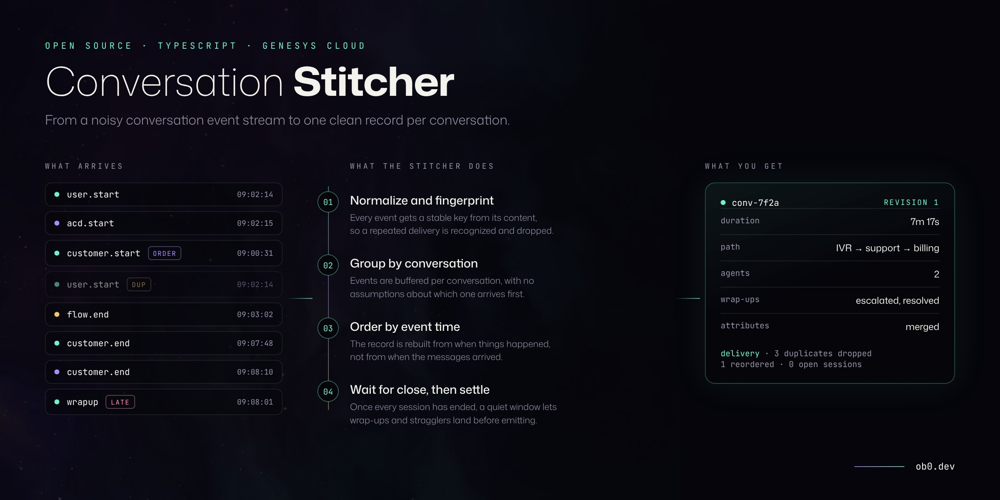

# genesys-conversation-stitcher

[](https://github.com/oebh2408/genesys-conversation-stitcher/actions/workflows/ci.yml)


Genesys Cloud publishes each change in a conversation as a separate event: customer connected, call queued, agent answered, disconnect, wrap-up. In practice those events can arrive duplicated, out of order, or after the conversation has already ended. Most consumers (a CRM sync, a data warehouse, reporting) need one complete record per conversation instead.

This library groups the events by conversation, waits until the conversation is finished and emits that record. It has no runtime dependencies, runs in a long-running process or in serverless functions, and includes a simulator so it can be tried without a Genesys account.



<sub>Output of the built-in simulator (`npm install && npm run demo`).</sub>

## What it handles

| Stream behaviour | Effect if consumed as-is | Handling |
| --- | --- | --- |
| Same event delivered twice | Transfers or wrap-ups counted twice | Events are fingerprinted by content; repeats are dropped |
| Events delivered out of order | Agent connected before the customer | The record is built in event-time order, not arrival order |
| Customer disconnect arrives before the agent's wrap-up | Record saved without the wrap-up code | Emits only after every session has ended, plus a settle window |
| Event arrives after the record was emitted | Event is lost | Emits a new revision of the record (or drops the event, configurable) |
| End of conversation never arrives | Conversation kept in memory indefinitely | Idle timeout emits what is known, with `closeReason: "timeout"` |
| Messaging conversation stays open for days | State grows with every event | Older events are compacted; state size is bounded |
| Snapshot topics send the full conversation on every change | Same session counted many times | Snapshots are converted to events with stable fingerprints, so repeats are dropped |

## Install

```bash
npm install genesys-conversation-stitcher
```

Node 18 or later. ESM only.

## Usage

There are two flavours with the same rules and the same output:

- `ConversationStitcher` keeps state in memory. For a worker or container that runs all the time.
- `StoredConversationStitcher` keeps state per conversation in a database. For serverless functions, see [Serverless](#serverless).

```ts
import { ConversationStitcher } from "genesys-conversation-stitcher";

const stitcher = new ConversationStitcher({
  settleMs: 30_000,        // quiet time after the last session ends
  idleTimeoutMs: 4 * 3600_000,
  lateEvents: "revise",    // or "drop"
});

stitcher.onRecord((record) => {
  // One call per conversation (plus one per revision, if late events arrive).
  saveToWarehouse(record);
});

// Feed it notifications from wherever they reach you:
// an event bridge, a queue, the notifications websocket...
for await (const message of yourQueue) {
  stitcher.ingest(JSON.parse(message.body));
}

// Records are emitted by tick(). Run it on a timer...
const stop = stitcher.start(1_000);
// ...or call stitcher.tick() after each batch.
```

The stitcher never reads the clock on its own: `ingest(event, now)` and `tick(now)` both take the time as an argument (defaulting to `Date.now()`). That is what makes it deterministic to test and replay. See [ADR 0001](docs/adr/0001-deterministic-core.md).

### What you get

```jsonc
{
  "conversationId": "conv-00490b88",
  "revision": 1,
  "closeReason": "ended",            // "ended" | "timeout" | "flushed"
  "startTime": 1767258325509,
  "endTime": 1767258655883,
  "durationMs": 330374,
  "mediaTypes": ["voice"],
  "direction": "inbound",
  "participants": [ /* customer, ivr, acd, agents, each with their sessions */ ],
  "agents": ["agent-carla", "agent-felipe"],
  "queues": [
    { "queueId": "support", "enteredAt": 1767258348267, "leftAt": 1767258431827, "waitMs": 83560 },
    { "queueId": "billing", "enteredAt": 1767258540138, "leftAt": 1767258613673, "waitMs": 73535 }
  ],
  "wrapUps": [
    { "userId": "agent-felipe", "code": "escalated", "notes": "...", "time": 1767258547323 },
    { "userId": "agent-carla", "code": "sale", "notes": "...", "time": 1767258663404 }
  ],
  "attributes": { "survey": "no", "channel": "voice" },
  "timeline": [ /* every applied event, in event-time order */ ],
  "delivery": {
    "eventsReceived": 24,
    "eventsApplied": 17,
    "duplicatesDropped": 7,
    "outOfOrderEvents": 1,
    "lateEvents": 0,
    "openSessions": 0,
    "compactedEvents": 0,
    "timelineEntriesDropped": 0
  }
}
```

`delivery` counts duplicates, reordering and late events for the conversation, which is useful for monitoring the pipeline.

## Serverless

Serverless functions keep no state between invocations and may run in parallel. `StoredConversationStitcher` stores each conversation separately in a `ConversationStore`:

- Each conversation is one row (or key). An invocation only loads the conversations in its batch.
- Writes are conditional on the version that was read. If two invocations update the same conversation at the same time, one write fails and that invocation reloads and reapplies its events.
- Each row stores when it next needs attention, so the scheduled function only loads conversations that are due.
- Delivery is at-least-once. A record is marked as in delivery before the listener runs and confirmed after it returns. If the listener throws or the function stops halfway, the same revision is delivered again after `ackTimeoutMs`.

```
Genesys Cloud ──► queue ──► onEvents()    ── ingestAll() ──►  store
                            onSchedule()  ── tick() ───────►  store ──► your listener
                            (every ~10 s)
```

```ts
import { StoredConversationStitcher } from "genesys-conversation-stitcher";
import { PostgresConversationStore } from "./postgres-store.js";   // see examples/

const stitcher = new StoredConversationStitcher(new PostgresConversationStore(pool));
stitcher.onRecord(async (record) => upsert(record));   // may be async

export const onEvents = (batch) => stitcher.ingestAll(batch.messages.map((m) => JSON.parse(m.body)));
export const onSchedule = () => stitcher.tick(Date.now(), 500);
```

A store is four methods (`load`, conditional `save`, conditional `delete`, `due`), so any database with a conditional write works: SQL, a key-value store with compare-and-set, a document store with ETags. The package ships `MemoryConversationStore` for tests, and [examples/](examples/) has a tested PostgreSQL store and a complete pair of handlers. Design notes in [ADR 0005](docs/adr/0005-serverless-store-and-optimistic-concurrency.md).

## How it decides a conversation is over

1. Every start event (`customer.start`, `flow.start`, `acd.start`, `user.start`) opens a session; the matching end closes it.
2. When every session seen so far has ended, a **settle window** starts (`settleMs`, 30 s by default).
3. Any new event for that conversation restarts the window. After-call work and wrap-up codes typically land here.
4. When the window passes quietly, the record is emitted.

The customer disconnecting is not enough, because the agent may still be in after-call work. Details and trade-offs in [ADR 0002](docs/adr/0002-closing-a-conversation.md).

## Try it without Genesys

The simulator generates realistic conversations (answered, transferred, abandoned in queue, messaging), then damages the stream on purpose: duplicates, reordering, latency and stragglers. It also returns the ground truth, so you can check the output.

```ts
import { ConversationStitcher, simulate, replay } from "genesys-conversation-stitcher";

const { deliveries, truth } = simulate({
  conversations: 50,
  seed: 7,             // same seed, same stream
  duplicateRate: 0.3,
  reorderRate: 0.3,
  straggleRate: 0.05,  // events that arrive after the record was emitted
  format: "detail",    // or "snapshot": the whole conversation on every change
});

const records = replay(new ConversationStitcher(), deliveries);
```

From the command line, in a clone of this repository:

```bash
npm run demo -- --conversations 100 --seed 3 --straggle 0.05
npm run demo -- --json > records.json
```

## Surviving restarts (in-memory flavour)

`ConversationStitcher` keeps state in memory. To survive a deploy or a crash, persist a snapshot and restore it on boot:

```ts
await kv.put("stitcher", JSON.stringify(stitcher.snapshot()));
// later
stitcher.restore(JSON.parse(await kv.get("stitcher")));
```

Combined with re-delivery from your queue, duplicates are dropped by fingerprint, so replaying a few minutes of events is safe. See [ADR 0004](docs/adr/0004-in-memory-state-with-snapshots.md).

## Long conversations

A messaging conversation can stay open for days and collect thousands of events. Keeping all of them would make every conversation's state grow without limit, which hurts most in serverless mode, where the state is read and written on every batch.

Once a conversation holds more than `compactAfterEvents` raw events (500 by default), the ones older than `compactLagMs` (15 min) behind the newest event are folded into a compact summary and dropped. Only their fingerprints are kept for a while, so late duplicates are still recognized. Recent events stay raw, so normal reordering is still handled exactly. The timeline keeps its first entry and the most recent ones (`maxTimelineEntries`, 1000).

In the test suite, a conversation with 100,000 events is processed in about 1.3 s and its stored state stays around 300 KB. `delivery.compactedEvents` shows how many events were compacted. Trade-offs in [ADR 0006](docs/adr/0006-compacting-long-conversations.md).

## Input format

The default adapter understands two families of Genesys Cloud topics. Use whichever your integration already subscribes to; mixing both for the same conversation is not recommended, because their timestamps can differ by a few milliseconds.

**Detail events**, `v2.detail.events.conversation.{id}.{kind}`: one small event per change. Fields read from `eventBody` when present: `eventTime` (epoch ms or ISO 8601), `conversationId`, `participantId`, `sessionId`, `participantPurpose`, `mediaType`, `direction`, `queueId`, `userId`, `ani`, `dnis`, `disconnectType`, `wrapupCode`, `wrapupNotes`, `attributes`.

**Conversation snapshots**, `v2.conversations.{id}`, `v2.users.{id}.conversations`, `v2.routing.queues.{id}.conversations`: the whole conversation on every change. Each snapshot is turned into the equivalent start, end, wrap-up and attribute events. Their fingerprints depend only on what they describe, so the same session seen in ten snapshots is applied once. Fields read per participant: `id`, `purpose`, `userId`, `queueId`, `ani`, `dnis`, `attributes`, `wrapup` (`code`, `notes`, `endTimestamp`), and per media session in `calls`, `callbacks`, `chats`, `emails` and `messages`: `id`, `direction`, `connectedTime`, `disconnectedTime`, `disconnectType`. Details in [ADR 0007](docs/adr/0007-snapshot-topics-as-events.md).

Payloads differ between organizations and topic versions, so treat the adapters as a starting point. Pass your own with the `normalize` option to map any other shape; it may return one event, several, or `null`:

```ts
import { ConversationStitcher, normalizeNotification } from "genesys-conversation-stitcher";

new ConversationStitcher({
  normalize: (n) => n.topicName.startsWith("my.custom.") ? myAdapter(n) : normalizeNotification(n),
});
```

## API

| Member | Description |
| --- | --- |
| `new ConversationStitcher(options?)` | `settleMs`, `idleTimeoutMs`, `lateEvents`, `retainEmittedMs`, `compactAfterEvents`, `compactLagMs`, `maxTimelineEntries`, `normalize` |
| `ingest(notification, now?)` | Returns `{ status }`: `applied`, `duplicate`, `late`, `late-dropped` or `ignored` |
| `ingestAll(notifications, now?)` | Same, for a batch |
| `tick(now?)` | Emits ready conversations and returns them; forgets expired ones |
| `flush(now?)` | Emits everything pending, e.g. on shutdown |
| `start(intervalMs?)` | Calls `tick()` on a timer; returns a stop function |
| `onRecord(listener)` | Subscribe to emitted records; returns an unsubscribe function |
| `snapshot()` / `restore(snapshot)` | JSON-safe state for persistence |
| `size` / `pending` | Conversations in memory / waiting to be emitted |
| `new StoredConversationStitcher(store, options?)` | Same options plus `ackTimeoutMs` and `maxAttempts`; `ingest`, `ingestAll` and `tick` return promises |
| `MemoryConversationStore` | Reference `ConversationStore`, kept in memory |
| `consolidate(events)` | The pure folding function, if you want to bring your own buffering |
| `normalizeNotification` / `normalizeDetailEvent` / `normalizeConversationSnapshot` | The built-in adapters |
| `simulate(options?)` / `replay(...)` / `replayStored(...)` | Simulator and simulated-clock runners |

## Design decisions

- [0001 · A deterministic core driven by an explicit clock](docs/adr/0001-deterministic-core.md)
- [0002 · Closing a conversation: all sessions ended, then a settle window](docs/adr/0002-closing-a-conversation.md)
- [0003 · Idempotency by content fingerprint, late events as revisions](docs/adr/0003-idempotency-and-revisions.md)
- [0004 · In-memory state with snapshots, no built-in storage](docs/adr/0004-in-memory-state-with-snapshots.md)
- [0005 · Serverless: per-conversation store and optimistic concurrency](docs/adr/0005-serverless-store-and-optimistic-concurrency.md)
- [0006 · Compacting long conversations](docs/adr/0006-compacting-long-conversations.md)
- [0007 · Snapshot topics as events](docs/adr/0007-snapshot-topics-as-events.md)

## Development

```bash
npm install
npm test        # unit, concurrency and property tests against the simulator's ground truth
npm run demo
npm run demo:svg   # re-renders docs/demo.svg from the real demo output
```

## License

MIT © [Oscar Benavides](https://ob0.dev)

Not affiliated with or endorsed by Genesys. Genesys Cloud is a trademark of its owner.
